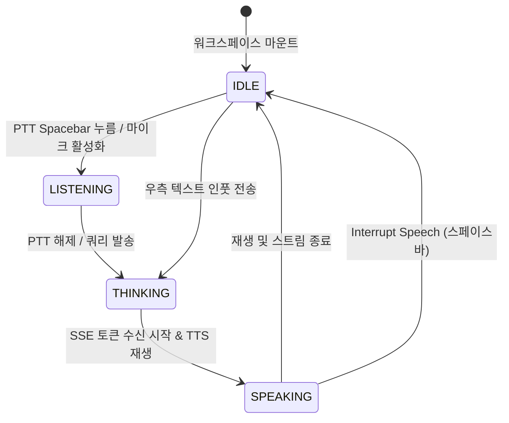

# 기능 명세서: AI 워크스페이스 (JARVIS Neural Core 음성 비서)

## 1. 개요 (Summary)
본 명세서는 `my-space` 프론트엔드 환경에 도입되는 **SF 미래형 실시간 음성 비서 AI 워크스페이스(JARVIS Neural Core)**의 UI 구조, 음성 인터랙션 흐름, 클라이언트 상태 관리 및 백엔드 스트리밍 연동 규격을 정의합니다.

기존의 단순 텍스트 챗봇(ChatGPT 스타일) 인터페이스를 탈피하여, 사용자와 AI 간의 음성 상호작용(Push-to-Talk, TTS 오디오 재생, 실시간 주파수 비주얼라이저)과 기술 텔레메트리(Benchmark Delta, 로컬/원격 지연율, 시냅스 코어 애니메이션)를 결합한 차세대 AI 인터페이스를 제공합니다.

---

## 2. 목표 및 제외 대상 (Goals / Non-goals)

### 2.1. 목표 (Goals)
1. **Stitch 디자인 100% 반영**:
   * 중앙 7컬럼: 다층 회전 궤도 링 및 SVG 시냅스 코어(J.A.R.V.I.S. Core), 실시간 이퀄라이저 사운드바, 전술 오디오 제어 바(Mute Mic, Interrupt Speech, 음성 선택), 하단 PTT 바.
   * 우측 5컬럼: 정갈한 패널 헤더, 미니 오디오 플레이어 캡슐(Waveform Pill), 발화 텍스트, Benchmark Delta 텔레메트리 카드, 참조 문서 링크 칩, 액션 툴바, 후속 질문 전용 인풋 바.
   * 좌측 사이드바: `NEURAL STREAMS` 세션 상태 태그(`LIVE`, `idle`, `saved`) 및 로컬 런타임 텔레메트리 인디케이터.
2. **반응형 음성 인터랙션 지원**:
   * 스페이스바 길게 누르기(`Push-to-Talk, PTT`) 기반 발화 시작 및 해제.
   * 단축키 지원 (`Alt+M`: 마이크 음소거 토글, `Space`: 즉시 발화 중단 / Interrupt Speech, `Shift+Enter`: 후속 텍스트 줄바꿈).
   * Web Audio API / 오디오 비주얼라이저 시뮬레이션 및 실제 재생 제어.
3. **Vanilla CSS 기반 초경량 고성능 애니메이션**:
   * 외부 프레임워크(Tailwind CSS) 없이, 순수 CSS 키프레임(`spin-slow`, `spin-rev`, `pulse-glow`, `sound-bar wave-bounce`)으로 부드러운 60fps 그래픽 제공.
4. **SSE 스트리밍 기반 실시간 응답 출력**:
   * 백엔드 스트리밍 청크 수신 시 텍스트 타이핑 효과와 음성 재생 상태(`SPEAKING`, `LISTENING`, `THINKING`)의 긴밀한 동기화.

### 2.2. 제외 대상 (Non-goals)
1. 브라우저 내 실제 On-Device 거대 언어 모델(LLM) 구동(WASM 파라미터 로딩 등)은 이번 범위에서 제외하며, 백엔드 API와의 통신을 통해 처리합니다.
2. 복잡한 다중 사용자 실시간 음성 회의(WebRTC Mesh/SFU)는 지원하지 않으며, 단일 사용자 대 음성 비서 1:1 세션에 집중합니다.

---

## 3. 유스케이스 및 사용자 흐름 (Use Cases)

### UC-01: 음성 Push-To-Talk(PTT) 질의
* **흐름**:
  1. 사용자가 메인 스테이지 하단의 `PTT: Hold Space` 버튼을 클릭하거나 스페이스바를 누르고 유지합니다.
  2. 시스템 상태가 `LISTENING`으로 전환되며, 코어 글로우와 웨이브폼이 마이크 입력 감지 모드로 동작합니다.
  3. 사용자가 키를 떼면 시스템 상태가 `THINKING`으로 전환되고 백엔드로 음성 쿼리가 전달됩니다.
  4. 응답 도착 시 `SPEAKING` 상태로 전환되며 우측 패널에 트랜스크립트가 출력되고 음성 플레이어 캡슐이 재생됩니다.

### UC-02: 텍스트 후속 질문(Follow-up Query)
* **흐름**:
  1. 음성 발화 청취 중 또는 답변 완료 후, 사용자가 우측 패널 하단의 `Reply or ask follow-up...` 인풋에 텍스트를 입력합니다.
  2. `Enter` 키 또는 전송 화살표 버튼(`arrow_upward`)을 클릭합니다.
  3. 백엔드 스트리밍 엔드포인트로 질문이 전송되고, 실시간 토큰이 트랜스크립트에 누적 출력됩니다.

### UC-03: 전술 오디오 제어 (Mute & Interrupt)
* **흐름**:
  1. AI가 음성 및 텍스트를 출력하는 도중 사용자가 `Interrupt Speech`(단축키 `Space`)를 누르면, 즉시 TTS 재생이 중단되고 스트림이 정지됩니다.
  2. `Mute Mic`(`Alt+M`) 클릭 시 마이크 수음이 차단되고 붉은색 음소거 아이콘으로 상태가 토글됩니다.

### UC-04: 마크다운 문서 연동 및 복사
* **흐름**:
  1. AI의 답변 카드 하단에서 `Save to Markdown` 버튼을 누르면 해당 답변 및 벤치마크 내용이 `my-space` 마크다운 문서 스튜디오의 새 문서로 즉시 생성/저장됩니다.
  2. `Copy` 버튼 클릭 시 서식이 클립보드에 복사됩니다.

---

## 4. 화면 및 컴포넌트 요구사항 (UI / Component Specs)

```
apps/web/src/
├── entities/ai/
│   ├── model/types.ts           # 세션, 메시지, 텔레메트리, 오디오 상태 인터페이스
│   ├── api/aiClient.ts          # REST/SSE 스트리밍 API 통신 함수
│   └── hooks/useAiStream.ts     # 실시간 스트리밍 및 상태 제어 커스텀 훅
├── features/ai/
│   ├── neural-core/             # 중앙 7컬럼: JARVIS 홀로그래픽 코어 & 비주얼라이저
│   │   ├── JarvisHoloCore.tsx
│   │   ├── VoiceVisualizer.tsx
│   │   └── TacticalAudioBar.tsx
│   ├── transcript-panel/        # 우측 5컬럼: 트랜스크립트, 플레이어, 벤치마크, 인풋
│   │   ├── AudioPlayerPill.tsx
│   │   ├── SpokenMessageCard.tsx
│   │   ├── BenchmarkDeltaCard.tsx
│   │   └── FollowUpInputBar.tsx
│   └── neural-streams/          # 좌측 사이드바: 신경망 세션 스트림 리스트
│       └── NeuralStreamList.tsx
└── pages/ai/
    ├── AiWorkspacePage.tsx      # 최상위 레이아웃 조립 페이지
    └── ai-workspace-page.css    # 100% Vanilla CSS 스타일 & 홀로그래픽 애니메이션
```

### 4.1. 주요 컴포넌트 세부 명세

1. **`JarvisHoloCore` (홀로그래픽 신경망 코어)**:
   * **CSS 애니메이션**:
     * 외곽 링 회전: `.holo-spin` (28초 시계방향)
     * 보조 링 역회전: `.holo-spin-rev` (22초 반시계방향, 점선 테두리)
     * 내부 주파수 링: `.holo-spin-fast` (14초)
     * 중심 발광 구체: `.holo-pulse` (3.5초 주기 은은한 펄스 글로우)
   * **SVG 시냅스 노드**:
     * 중심 핵(Core) + 궤도 타원 2개 + 9개의 연결 노드(Constellation Synaptic Nodes).
     * 상태에 따라 시냅스 라인 발광 (JARVIS: Stark Blue/Amber/Mint).
   * **중앙 HUD 오버레이**:
     * `CORE: ACTIVE` (소형 라벨), `J.A.R.V.I.S.` (헤드라인 모노), `98.4% SYNAPSE` (서브 메트릭).

2. **`VoiceVisualizer` & `TacticalAudioBar` (오디오 & 전술 제어)**:
   * 상태 배지: `SPEAKING (TTS STREAMING)` 또는 `LISTENING`, `STANDBY`.
   * 사운드바: 10개 수직 바의 가변 높이 바운스 애니메이션 (`wave-bounce`).
   * 계측 수치: `VOL: -14.2 dBFS` • `PITCH: 118 Hz` • `SYNTH BUFFER: 384 ms`.
   * 제어 버튼:
     * `Mute Mic` (`Alt+M` kbd 태그 포함)
     * `Interrupt Speech` (`Space` kbd 태그 포함)
     * 보이스 셀렉터: `JARVIS British AI ▾`
     * 배속: `1.0x`

3. **`SpokenMessageCard` & `BenchmarkDeltaCard` (우측 패널)**:
   * 헤더: `J.A.R.V.I.S.` + 모델 배지(`Opus`) + 온라인 펄스 램프 + 툴 액션(`add`, `delete_sweep`, `more_horiz`).
   * 오디오 알약 캡슐(`AudioPlayerPill`): 재생/일시정지 토글, 미니 6바 웨이브폼, 재생 타임코드 (`0:14 / 0:38`).
   * 발화 본문: 키워드 강조가 들어간 유려한 타이포그래피.
   * `BenchmarkDeltaCard`:
     * 다크 콘솔 스타일 카드, 상단에 `BENCHMARK DELTA` 및 에이전트 라벨(`local-storage-worker`).
     * 로컬 OPFS 스트림 vs 원격 SSE 지연율 및 락 발생 횟수 표시.
   * 참조 문서 태그: `mongodb-streaming.md`, `architecture-notes.md` 클릭 가능한 칩.
   * 툴바: 복사, 마크다운 문서로 저장, 추천/비추천, 재시도.

4. **`FollowUpInputBar` (후속 텍스트 인풋)**:
   * 플레이스홀더: `Reply or ask follow-up...`
   * 파일 첨부 아이콘 + 전송 화살표 버튼(`arrow_upward`).
   * 힌트 문구: `Shift + Return for newline` (좌) / `GPT-4o / WASM` (우).

---

## 5. 클라이언트 상태 및 데이터 흐름 (State & Data Flow)

### 5.1. 핵심 클라이언트 상태 (State Matrix)
* **`aiEngineState`**: `'IDLE' | 'LISTENING' | 'THINKING' | 'SPEAKING'`
* **`activePersona`**: `'JARVIS'` (단일 페르소나 고정)
* **`audioSettings`**:
  * `isMicMuted`: boolean
  * `speechSpeed`: 1.0 | 1.25 | 1.5
  * `selectedVoice`: string (예: `'JARVIS British AI'`)
* **`activeStreamSession`**:
  * `id`: string
  * `title`: string
  * `status`: `'LIVE' | 'idle' | 'saved'`
  * `messages`: `SpokenTranscriptMessage[]`
  * `benchmarkDelta`: `BenchmarkMetrics | null`

### 5.2. 상태 전이 다이어그램 (Mermaid)



---

## 6. API 연동 규격 (API Integration)

* **백엔드 통신 기본 정책**:
  * 백엔드 API 계약(`/api/v1/ai/...`)에 맞추어 클라이언트 연동 계층 구성.
  * SSE 엔드포인트: `/api/v1/ai/chat/stream`
  * 세션 관리 엔드포인트: `/api/v1/ai/sessions`
* **모의(Mock) 및 오프라인 안전 모드**:
  * 백엔드 음성 처리 및 서버가 아직 준비되지 않은 개발 환경에서도 UI 인터랙션, PTT 및 JARVIS 시각 효과가 매끄럽게 동작하도록 안전한 모의(Mock) 시뮬레이션 데이터 제공.

---

## 7. 에러 핸들링 및 접근성 (Error Handling & a11y)

1. **마이크 권한 거부**:
   * 브라우저 마이크 권한이 차단된 경우, PTT 버튼에 경고 아이콘 표시 및 텍스트 입력창으로 포커스 안내.
2. **스트리밍 단절 복구**:
   * 네트워크 유실 시 `Retry` 버튼을 통한 마지막 발화 재전송 지원.
3. **접근성(a11y)**:
   * 모든 인터랙티브 컨트롤에 명확한 `aria-label` 및 키보드 포커스 ring 부여.
   * `prefers-reduced-motion` 미디어 쿼리를 지원하여 필요시 궤도 회전 애니메이션 감속 처리.

---

## 8. 의사결정 사항 (Decisions on Open Questions)
1. **Web Audio 실제 음성 녹음 API 연동**:
   * 현재 프론트엔드 단계에서는 UI/UX 및 가상 오디오 텔레메트리 시뮬레이션을 구현하며, 백엔드 음성 처리 개발 완료 후 전달받아 정식 결합합니다.
2. **단일 JARVIS 페르소나 채택**:
   * 별도의 Ultron 모드는 제외하고, 오직 완성도 높은 J.A.R.V.I.S. Core 단일 인터페이스로 집중 구현합니다.
